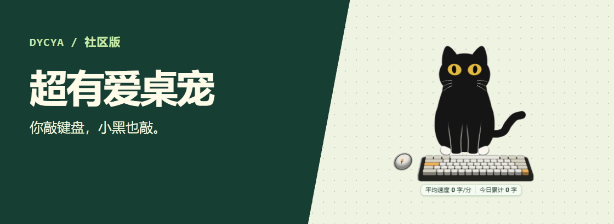
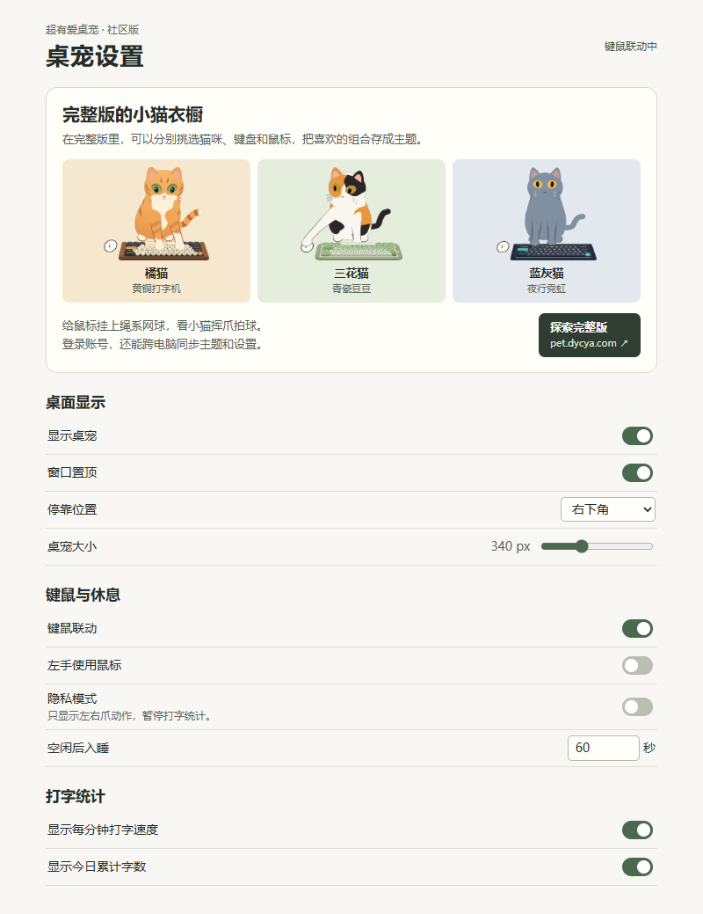

# 超有爱桌宠 · 社区版

小黑趴在自己的键盘前陪你打字。你敲左手边的键，它就伸左爪；你停下来一会儿，它也会收起爪子打盹。社区版把经典小黑、键盘和鼠标都装在本地，解压就能用，无需账号。

**[下载 Windows x64 便携版](https://github.com/mqllin/cya-desktop-pet/releases/latest)**　·　[官网试玩](https://pet.dycya.com/#demo)　·　[反馈问题](https://github.com/mqllin/cya-desktop-pet/issues)

## 把小黑放到桌上

1. 打开上方下载页，选择 `.zip` 文件，右键选择「全部解压缩」。
2. 双击解压出的桌宠 EXE。打开记事本敲几个字，看看小黑跟不跟得上。
3. 右键小黑或托盘图标进入「桌宠设置」。想挪个位置，选择「编辑位置与大小」，拖动到喜欢的角落即可。

Windows 首次运行时可能提示「发布者未知」。当前 Windows 发布包使用 `dycya.com` 自签名。下载页提供 ZIP 的 SHA-256，包内的《证书报错说明》解释了这个提示。

## 按你的习惯来

| 想做什么 | 在哪里调整 |
| --- | --- |
| 用左手握鼠标 | 在设置中切换鼠标惯用手，小黑也会换边。 |
| 看看今天打了多少字 | 分别开启「每分钟打字速度」和「今日累计字数」。 |
| 只看小黑敲键的动作 | 开启隐私模式，只传递左右手动作，暂停打字计数。 |
| 让小黑早点打盹 | 调整空闲入睡时间。窗口置顶、桌面位置和大小也可以自选。 |

<details>
<summary>查看设置窗口</summary>



</details>

设置与当日打字汇总保存在本机的 `%APPDATA%/typing-desktop-pet-open/desk-pet.json`。想给小黑换猫咪花色、键盘或鼠标，可以去官网体验带皮肤衣橱的完整版。[查看完整版搭配](https://pet.dycya.com/#wardrobe)

## 从源码运行

安装 Node.js 22.12 或更高版本，在仓库根目录执行：

```sh
npm ci
npm run check
npm start
```

只看设置窗口可运行 `npm start -- --settings`。在 Windows 构建 x64 便携 EXE 时运行 `npm run dist:win`，产物位于 `dist/`。

## 许可与署名

本次发布的原创代码和随附原创美术素材使用 **PolyForm Noncommercial 1.0.0**。欢迎按许可学习、修改和非商业分享，并保留署名及许可说明。销售软件副本、将其打包进收费产品等商业用途需另行取得作者授权。[许可全文](LICENSE) · [署名声明](NOTICE.txt)

Three.js 与 GLTFLoader 保留各自的 MIT 许可。[Three.js 许可证](app/vendor/THREE-LICENSE.txt)
